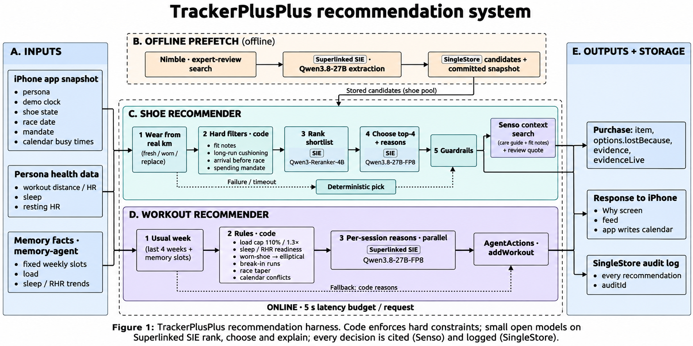

# Tracker++

**A personal agent that makes sure your workout happens.**

> Google and Apple coach your workout. We make sure it happens.

Tracker++ is an iOS agent that protects your workout plan instead of just writing one. It notices a missed session and books a shorter comeback, moves a workout when a meeting lands on it, buys what your training needs under a spending rule you set once, and shows its reasoning for every action. Built for the [Personal Agents Hackathon](https://luma.com/personalagenthack) (San Francisco, November 2026).



## Contents

- [What it does](#what-it-does)
- [Architecture](#architecture)
- [Repository layout](#repository-layout)
- [Quick start](#quick-start)
- [The harness API](#the-harness-api)
- [Sponsors and tools](#sponsors-and-tools)
- [Demo](#demo)
- [Design principles](#design-principles)
- [Status and roadmap](#status-and-roadmap)
- [Team](#team)

## What it does

| | |
|---|---|
| **Recovers after a miss** | Missed your lunchtime walk? The agent books a shorter comeback this evening for double points, with Undo and "Pick another time". |
| **Defends the slot** | A meeting lands on tomorrow's run. The agent moves or shortens it before it's missed and says why in its feed. |
| **Shops with an audit trail** | Your shoes hit 390 miles nine days before your race. The agent researches real shoes on the web, picks one for how you train, explains why every other option lost, cites its sources, and waits for your OK (anything over $20 asks first; small things like a $15 rainy-day gym pass are booked and can cancel themselves). |
| **Plans your week** | The next 7 days come from your usual routine and memory, adjusted for training load, sleep and resting heart rate, worn shoes, a race taper and your calendar. Optional extras from expert guidance are suggested, never forced. |
| **Remembers you** | A memory layer turns health data into exact facts ("runs Tue 18:00 in 3 of the last 4 weeks", "load 1.14× the 4-week average") that shape every plan. |
| **Shows its work** | Every action has a reason, every recommendation has citations, and every decision is logged as an audit record. |

No real money moves: every checkout is a clearly labeled demo store. All health data is synthetic.

## Architecture

```
┌──────────────── iPhone app (SwiftUI) — the hands ────────────────┐
│ Health + calendar snapshot · memory · demo controls              │
│ Today card · Why screen · feed · TrackerPlusPlus calendar        │
│ notifications · Live Activity · Undo / Order it / Not now        │
└───────────────┬───────────────────────────────▲──────────────────┘
                │ POST /shoes/recommend         │ Purchase, AgentActions,
                │ POST /workouts/recommend      │ reasons, citations, auditId
┌───────────────▼───────────────────────────────┴──────────────────┐
│ Harness (Python, FastAPI on Vercel) — the brain, stateless       │
│  code: hard rules (fit, load cap, readiness, taper, mandate)     │
│  Superlinked SIE: rerank + small open models choose and explain  │
│  Senso: cited knowledge · Nimble: web research (prefetched)      │
│  SingleStore: shoe candidates + audit log                        │
└──────────────────────────────────────────────────────────────────┘
        memory-agent (JS): daily facts from health data → planner
```

The phone keeps the memory and does every write (calendar, notifications, the pretend order). The harness decides and explains, and stores nothing between calls except its audit log. Each recommendation answers within a 5-second budget and falls back to a deterministic answer if a model or service is slow, so the demo never depends on a live call.

## Repository layout

| Path | What's there |
|---|---|
| [`app/`](app/) | The iOS app: SwiftUI + SwiftData, iOS 18+, Swift 6. Agent stand-in, calendar sync, slot defense, the shopping beat, notifications, Live Activity. [README](app/README.md) |
| [`harness/`](harness/) | The recommendation backend: shoe and workout recommenders, web research, Senso evidence, SingleStore audit log. [README](harness/README.md) · [app integration](harness/INTEGRATION.md) |
| [`memory-agent/`](memory-agent/) | The memory layer: facts from health snapshots and feedback, Amplitude events. Runs in iOS JavaScriptCore; Node for tests. [README](memory-agent/README.md) |
| [`MockData/`](MockData/) | Synthetic Apple Health exports for three personas: Sam (inactive), Alex (moderate), Jordan (half-marathon training). |
| [`docs/designs/`](docs/designs/) | Design docs: the [main plan](docs/designs/trackerplusplus-hackathon.md), the [shopping beat](docs/designs/trackerplusplus-shopping-beat.md), the [recommendation harness](docs/designs/trackerplusplus-recommendation-harness.md). |
| [`docs/figures/`](docs/figures/) | The system figure above. |
| [`demo-video/`](demo-video/) | Screen recordings of each demo beat. |
| [`DESIGN.md`](DESIGN.md) | The design system: colors, type, spacing, components. |

## Quick start

### iOS app

Requires Xcode 26 and an iPhone simulator (or a phone with a development team).

```sh
open app/TrackerPlusPlus.xcodeproj      # then Run
```

Demo controls are on by default in Debug builds (the floating button). See [app/README.md](app/README.md) for the Sam and Jordan stories.

### Harness

Requires [uv](https://docs.astral.sh/uv/).

```sh
cd harness
uv sync
cp .env.example .env          # add your keys (see below)
uv run pytest -q              # 34 tests
PYTHONPATH=. uv run uvicorn api.index:app --port 8000
```

| Variable | Needed for |
|---|---|
| `SUPERLINKED_API_KEY` | Ranking, choosing and explaining (SIE Serverless) |
| `SENSO_API_KEY` | Live citations (falls back to cached passages) |
| `NIMBLE_API_KEY` | Web research, only for the prefetch scripts |
| `SINGLESTORE_URL` | Candidate store and audit log (optional) |
| `HARNESS_SECRET` | Protects the paid routes (`X-Harness-Secret` header) |

Deployed at `https://trackerplusplus-harness.vercel.app`. Deploy with `npx vercel deploy --prod --yes` from `harness/`.

### Memory agent

Requires Node 20+.

```sh
cd memory-agent
node scripts/demo.mjs half_marathon
npm install && npm test
```

## The harness API

| Route | Secret | What it returns |
|---|---|---|
| `GET /health` | | Which services are configured |
| `POST /warm` | ✓ | Loads the SIE models and SingleStore candidates. Run before a demo. |
| `POST /shoes/recommend` | ✓ | Shoe condition + a `Purchase`: the pick, every option with why it lost, citations, photos, `auditId` |
| `POST /workouts/recommend` | ✓ | The next 7 days as calendar-ready actions, with reasons, citations, optional suggestions, `auditId` |
| `POST /evidence` | | Cited passages for a purchase (Senso) |
| `POST /shoes/prefetch` | ✓ | Re-runs the web research into SingleStore |
| `GET /audit/recent`, `GET /audit/{id}` | ✓ | The audit trail |

```sh
curl -s https://trackerplusplus-harness.vercel.app/shoes/recommend \
  -H 'content-type: application/json' -H "X-Harness-Secret: $SECRET" \
  -d '{"persona":"jordan","now":"2026-11-20T09:00:00-08:00",
       "shoes":{"boughtOn":"2026-10-22","startMiles":267},"raceDate":"2026-11-29","mandate":[]}'
```

Full request and response shapes are in [harness/README.md](harness/README.md); wiring them into the app is in [harness/INTEGRATION.md](harness/INTEGRATION.md).

## Sponsors and tools

| | Used for |
|---|---|
| **[Superlinked](https://superlinked.com)** | SIE Serverless: `Qwen3-Reranker-4B` ranks shoe shortlists; `Qwen3.8-27B-FP8` extracts shoes and workout ideas from the web, picks a shoe and writes every reason |
| **[Senso](https://senso.ai)** | Knowledge base and context search: the citations on the Why screen |
| **[SingleStore](https://singlestore.com)** | Web shoe candidates and a permanent audit record of every recommendation |
| **[Amplitude](https://amplitude.com)** | Recommendation and workout events from the memory agent |
| [Nimble](https://nimbleway.com) | Web search of expert reviews and training guidance |
| [Vercel](https://vercel.com) | Hosts the harness |
| [Claude Code](https://claude.com/claude-code) · GPT Astra | Built with AI pair programming; the system figure was generated with GPT Astra |

## Demo

1. **Jordan's shoes.** The agent notices his pair is at 97% of its life nine days before his half marathon, researches real shoes, and asks before spending $170 on a New Balance Fresh Foam X 1080 v15. Why this pair shows the rule, the wear, citations and the shoes that lost.
2. **Order it.** Two break-in runs land on his calendar, and his week adapts: Sunday's long run moves to the elliptical until the new pair arrives.
3. **Sam's missed walk.** At 1:30 PM the agent has already booked a 15-minute comeback at 6:30 PM for double points.
4. **Rain at 6:30.** The agent buys a $15 day pass under the $20 rule and moves the walk indoors. When the forecast clears, it cancels its own purchase.
5. **The audit trail.** Every decision above is a record in SingleStore.

Recordings of each beat are in [`demo-video/`](demo-video/).

## Design principles

- **Code decides, models explain.** Hard constraints (training-load cap, fit notes, spending mandate, race taper) are enforced in code. Small open models rank, choose among safe options and write the reasons. They never override a rule.
- **Every action is reversible and explained.** Each action carries a reason and Undo; purchases over the mandate ask first.
- **Cite everything.** Recommendations point to their sources: expert reviews, the care guide, the person's own memory.
- **Never block the demo.** Every model or service call has a time limit and a deterministic fallback.
- **Grounded in evidence.** Comeback bonuses, loss-framed points and the training-load guardrail trace to published studies; see the [main design doc](docs/designs/trackerplusplus-hackathon.md).

## Status and roadmap

**Working:** the miss loop, slot defense and calendar sync; notifications and Live Activity; the shopping beat with ask-first and auto-buy branches; the harness shoe and workout recommenders, live on Vercel, with web research, citations, photos and the audit log; the memory agent with Amplitude.

**Next:**
- Wire the app to the harness routes ([integration guide](harness/INTEGRATION.md)).
- Feed taps (Undo, Not now, suggestions) back into memory; try Cognee as the memory store.
- Real HealthKit reads and workout import.
- Routines and the load guardrail inside the app ([TODOS.md](TODOS.md)).

## Team

Built in a day by a team of four: iOS, data and memory, the planner and harness, and design.
