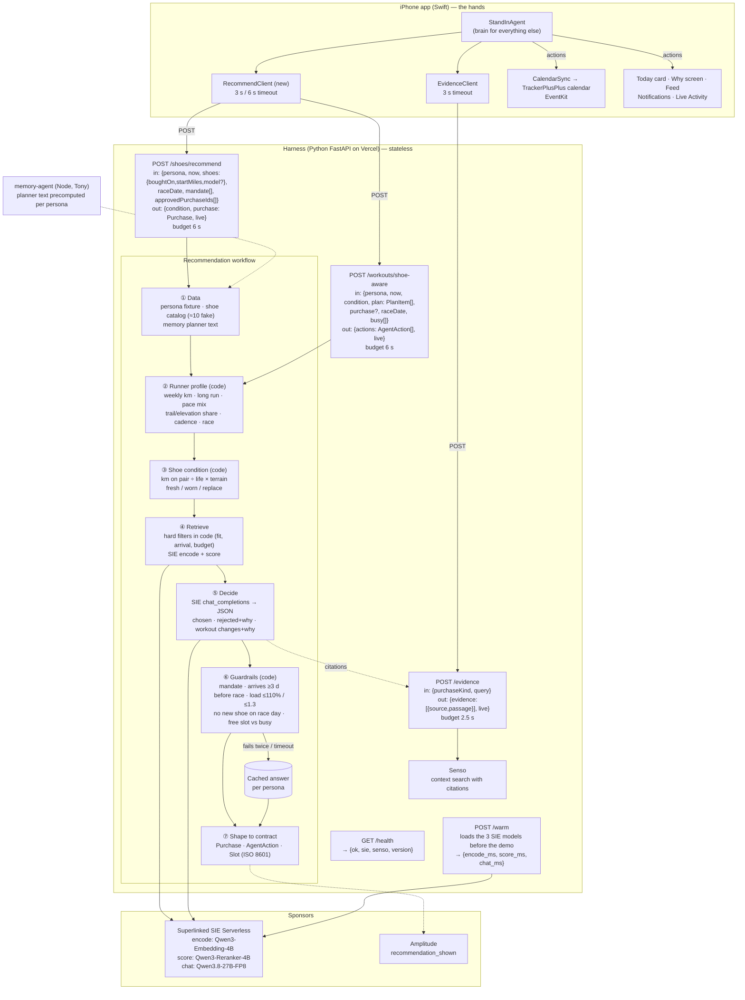

# Design: the recommendation harness (shoes and shoe-aware workouts)

Owner: Surya. Status: PROPOSED, 2026-11-20. Builds on `trackerplusplus-hackathon.md` and `trackerplusplus-shopping-beat.md`.

## Goal

Two recommendations, made on the backend from the fake persona data, that the app turns into real actions:

1. **Shoes:** the pair's real wear (from `distanceKm`, terrain and pace in the mock Health data) decides when to replace it. A shortlist from a fake catalog is ranked against how this person trains, and a model picks one, says why the others lost and cites its sources.
2. **Workouts based on the shoes:**
   - **Worn pair, new one not here yet:** shorter runs, or the long run moves to the bike or elliptical.
   - **New pair arriving:** a break-in ramp.
   - **Race week:** no new shoes on race day.

   Every change is a calendar-ready `AgentAction`, which the phone writes to the TrackerPlusPlus calendar.

The phone keeps doing the hands' work: EventKit calendar writes, notifications and the feed. The harness decides; it never touches the calendar.

## Review changes (GPT Astra outside review, 2026-11-20) — these override the sections below

1. **Phone integration.** The stand-in calls `/shoes/recommend` *inside* `shoesPurchase` (StandInAgent+Purchases.swift) and wraps the returned `Purchase` in its own `purchase-<id>` action. Swift keeps owning approval, cancellation, action ids, folding and the break-in runs; the harness only picks and explains. It uses a separate `recommend_url` setting, because `harness_url` swaps the whole agent. All dates are ISO 8601.
2. **One producer per id.** The harness returns no actions for shoes, only the `Purchase` payload, so nothing can duplicate.
3. **Fallbacks are recomputed, not replayed.** The fallback is a deterministic pick over the same filtered shortlist for the current `now`, race date and mandate. A stale persona cache is never replayed.
4. **One deadline:** a 5 s budget for the whole route (the phone waits 6 s). Measured on Jordan: 2.7–3.5 s live, about 0.3 s on the fallback. Warm before the stage with `scripts/warm.py` or `POST /warm`.
5. **Secret:** `/evidence` stays open because `EvidenceClient` sends no header. `/shoes/recommend` and `/warm` check `X-Harness-Secret` only when `HARNESS_SECRET` is set.
6. **Fixture honesty:** no terrain factor, since the fixture has no trail field. Wear comes from real `distanceKm` since `boughtOn`, plus `startMiles` converted once. The phone's race date overrides the fixture's Dec 6.
7. **Scope:** `/workouts/shoe-aware`, the simulation, the Claude fallback, Amplitude from the harness and the embedding model are deferred until `/shoes/recommend` works end to end on the phone. With 10 shoes, reranking the whole shortlist replaces embedding retrieval.

**Status (2026-11-20, branch `surya/recommendation-harness`, PR #13):** live at https://trackerplusplus-harness.vercel.app. `/shoes/recommend` picks from real shoes found in expert reviews (Nimble → Qwen extraction → SingleStore/snapshot), with photos, Senso citations and a SingleStore audit record. `/workouts/recommend` plans the next 7 days from health data, shoe condition and Tony's memory facts, with optional web suggestions. Also `/evidence`, `/warm`, `/shoes/prefetch`, `/audit/*`. 34 tests. See `harness/README.md`; the sections below are the original plan.

## Principles

- **Workflow, not an open agent loop**, as the Superlinked cookbook recommends. Code picks every step; small open models on SIE do the judging at each step. Same input, same steps.
- **Guardrails in code** check every model answer before it reaches the phone.
- **Never block the demo.** Each route answers within its time budget, or returns the cached answer for that persona with `live: false`. The Swift stand-in's hard-coded answer stays as the phone-side fallback.
- **Fake data only.** Persona fixtures from `MockData/output/*/health.json`, a fake shoe catalog, and the memory agent's planner text precomputed per persona.
- **Same shapes as the app.** Outputs use `Purchase`, `AgentAction` and `Slot` from `app/TrackerPlusPlus/Contract/Contract.swift`, with ISO 8601 dates.

## Sponsors

| Sponsor | Used for | Where |
|---|---|---|
| **Superlinked (SIE Serverless)** | `encode` with Qwen3-Embedding-4B (catalog and runner-need vectors); `score` with Qwen3-Reranker-4B (rerank the shortlist); `chat_completions` with Qwen3.8-27B-FP8 (the decision and explanations as JSON) | `recommend/retrieve.py`, `recommend/decide.py` |
| **Senso** | Cited passages for every recommendation (shoe-life guide, fit notes, listings, gym policy) | `evidence/senso.py`, `POST /evidence` |
| **Amplitude** | `recommendation_shown` events from the harness, using Tony's event schema (optional, off without a key) | `telemetry/amplitude.py` |
| Firedrill (stretch) | Simulate 4 weeks of Jordan against the routes: wear crosses the line, a pair arrives, a heavy week | `scripts/simulate.py` |

Not used today: Cognee (Tony built our own memory), Airbyte, SingleStore, Persona, Guild AI, Arcee, Statsig.

## API keys and settings

All of these live in the repo-root `.env` locally (git-ignored) and in Vercel environment variables when deployed. None go to the phone.

| Variable | Required | For |
|---|---|---|
| `SUPERLINKED_API_KEY` (or `SIE_API_KEY`) | **yes** | SIE Serverless. The harness reads either name. **Have it.** |
| `SENSO_API_KEY` | **yes for live evidence** | Senso search. Without it, `/evidence` returns cached passages with `live: false`. **Needed.** |
| `SENSO_BASE_URL` / knowledge-base id | with Senso | Which Senso collection Tony loaded. **Ask Tony.** |
| `SIE_BASE_URL` | no | Empty means SIE Serverless. |
| `HARNESS_SECRET` | recommended | Shared header `X-Harness-Secret` so a public URL can't spend credits (eng review R5). |
| `AMPLITUDE_API_KEY` | no | Harness-side events. |
| `ANTHROPIC_API_KEY` | no | Optional second fallback for `decide` if SIE is slow or returns bad JSON. |
| Vercel account | to deploy | Whose account hosts it is an open question in the main doc. |

## Block diagram



## Endpoints

All requests are `POST` with a JSON body, plus `X-Harness-Secret` if `HARNESS_SECRET` is set. Every success response carries `live` (true = models and Senso answered; false = cached). Errors return `4xx` with `{error}`; the phone treats any failure as "use my own answer".

### `POST /evidence` (already expected by `EvidenceClient.swift`)
- In: `{"purchaseKind": "shoes" | "dayPass", "query": "..."}`
- Out: `{"evidence": [{"source": "Shoe care guide", "passage": "..."}], "live": true}`
- Senso gets 2.5 s; after that, the bundled passages for the kind are returned with `live: false`.

### `POST /shoes/recommend`
- **In:**
  ```json
  {
    "persona": "jordan",
    "now": "2026-11-20T09:00:00-08:00",
    "shoes": {"boughtOn": "2026-10-20", "startMiles": 267},
    "raceDate": "2026-11-29",
    "mandate": [{"id": "ask-over-20", "text": "Ask me before anything over $20.", "category": "any", "maxAutoCents": 0}],
    "approvedPurchaseIds": []
  }
  ```
- **Out:**
  ```json
  {
    "condition": {"km": 631, "lifeKm": 650, "percentLife": 97, "status": "replace", "why": "..."},
    "purchase": {
      "id": "shoes-2026-10-20", "item": "Pacer 9", "merchant": "Demo store, no charge",
      "amountCents": 13800, "status": "awaitingApproval",
      "rule": {"id": "ask-over-20", "text": "..."},
      "noticed": "...", "evidence": [], "evidenceLive": true,
      "options": [{"name": "Pacer 9", "amountCents": 13800, "arrives": "...", "lostBecause": null}]
    },
    "live": true
  }
  ```
- `purchase` is `null` when the pair is fresh.

### `POST /workouts/shoe-aware`
- **In:** `{persona, now, condition, plan: PlanItem[], purchase?: Purchase, raceDate, busy: Busy[]}`
- **Out:** `{"actions": [AgentAction], "live": true}`, using only kinds the phone already applies:
  - `shrink` or `move` (`before`/`after` slots, an activity swap allowed in `after.activityType`)
  - `addWorkout` (break-in runs, carrying `purchaseId`)
  - `note`
- **Action ids are stable per input**, for example `shoeaware-<planItemId>-<status>`, so repeat calls never duplicate (the phone ignores ids it already has).

### `POST /warm` and `GET /health`
- Warm the three SIE models before the demo (cold starts can take minutes). Health reports which keys are configured, never their values.

## Directory structure

```
harness/
  README.md                 run, test, deploy, curl examples
  pyproject.toml            fastapi, uvicorn, pydantic, sie-sdk, httpx, python-dotenv, pytest
  vercel.json               routes everything to api/index.py
  api/
    index.py                FastAPI app: the routes above, secret check, time budgets
  harness/
    config.py               reads .env / env vars (either SIE key name)
    models.py               Pydantic mirror of Contract.swift (Slot, PlanItem, AgentAction, Purchase, ...)
    data/
      personas.py           loads MockData/output/<persona>/health.json (sam→sedentary, alex→moderate, jordan→half_marathon)
      catalog.json          ≈10 fake shoes: price, arrival days, cushion, drop, toe box, road/trail, life km, blurb
      memory/               planner text per persona, from memory-agent (sam.txt, alex.txt, jordan.txt)
      cached/               fallback answers per persona and route
      passages.json         cached Senso passages per purchase kind
    recommend/
      profile.py            ② runner profile
      condition.py          ③ shoe wear
      retrieve.py           ④ filters + SIE encode/score
      decide.py             ⑤ SIE chat_completions prompt + JSON schema
      guardrails.py         ⑥ checks, retry once, fall back to cache
      workouts.py           shoe-aware workout rules → AgentAction
    evidence/
      senso.py              Senso search, 2.5 s, cached fallback
    clients/
      sie.py                SIEClient wrapper: timeouts, error → fallback
    telemetry/
      amplitude.py          optional events
  scripts/
    build_memory.sh         runs memory-agent per persona → data/memory/
    warm.py                 calls /warm against a URL
    simulate.py             (stretch) 4-week Jordan simulation
  tests/
    test_profile.py         wear and profile numbers on the 3 fixtures
    test_guardrails.py      every guardrail rejects a bad answer
    test_routes.py          routes with SIE/Senso stubbed; offline → live:false
    test_contract.py        responses decode as the Swift shapes (golden JSON in contract/fixtures/)
    test_sie_smoke.py       one real SIE call per model (skipped without a key)
```

## Build order (cut lines in bold)

| By | Work |
|---|---|
| 12:45 | Skeleton, config, `/health`, `/warm`, SIE smoke test with the real key. `/evidence` with cached passages (Senso live once the key arrives). |
| 1:45 | Profile, condition, catalog, retrieve (SIE encode + score), decide (SIE chat), guardrails, `/shoes/recommend`, tests on all 3 personas. |
| **2:30** | **Cut line:** `/shoes/recommend` live on Vercel, sample JSON handed to Jonathan. If not ready, ship `/evidence` only. |
| 3:15 | `/workouts/shoe-aware`; memory text in the prompt; Amplitude events. Jonathan adds `RecommendClient` with fallbacks. |
| **3:30** | **Freeze.** Warm models, rehearse three times. |

## Open questions

- Senso: API key, base URL and the knowledge base Tony loaded.
- Vercel: whose account, and does the function time limit allow a 6 s budget? (It should on current plans; check at deploy.)
- Jonathan: about 30 minutes around 2:30 for `RecommendClient` and merging the returned actions.
- Should the shoe-aware workout changes appear in the Jordan demo script (step 2, after Order it), or as a separate beat before ordering ("your pair is at 97%, so Sunday's long run moves to the bike")?
